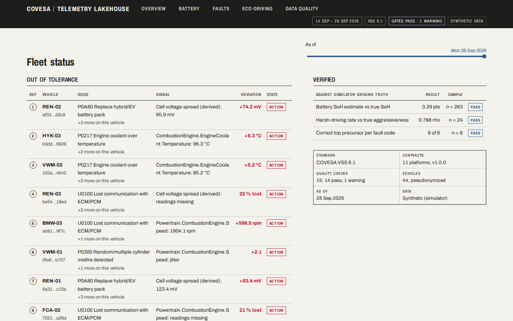
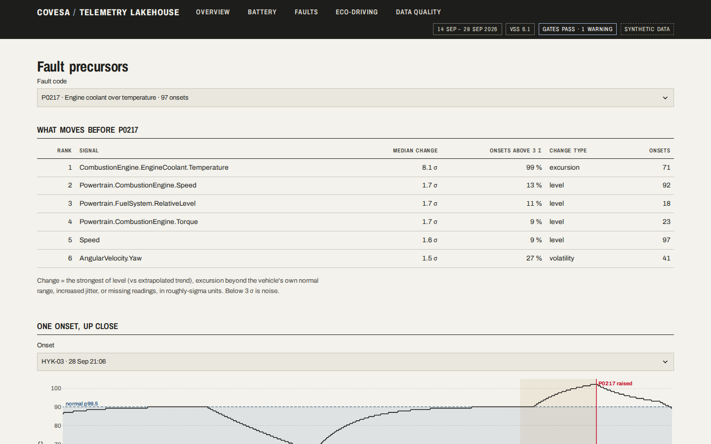
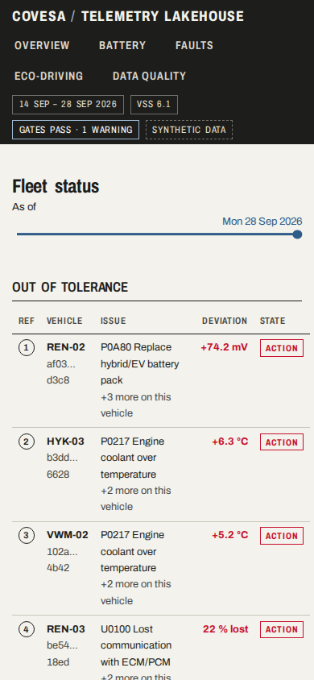

# COVESA-Compliant Telemetry Lakehouse

Multi-ECU and fleet signal harmonization for Software-Defined Vehicles: heterogeneous CAN / TCU
telemetry is landed, conformed to the [COVESA Vehicle Signal Specification](https://github.com/COVESA/vehicle_signal_specification)
and served as analytical marts, on a Medallion lakehouse (Bronze → Silver → Gold) built with
PySpark and Apache Iceberg.

> Status: **all six phases complete**: ingestion, conformance, analytics marts, orchestration with
> quality gates, and a fleet dashboard. Every KPI is validated against the simulator's ground truth.



## Context

This project started with a question I kept coming back to: what do you do when there are too many
data sources? Every new source arrives with its own format, its own names and its own units, and
if each one gets its own pipeline, the system grows harder to maintain with every source you add.

Connected vehicles are an extreme case of that problem. One fleet can mix many brands and
platforms, each with its own CAN signals, encodings and scalings, yet the people analysing the
fleet want to ask one question of all of it. When I came across the idea of conforming
heterogeneous vehicle telemetry to a shared standard, the COVESA Vehicle Signal Specification, it
answered my question directly, so I built it.

The approach this repository takes:

* **Describe each source, don't code it.** A platform is onboarded with a contract file that maps
  its signals to VSS, not with new pipeline code. One generic engine reads every contract.
* **Never lose data, never stop for it.** Raw data is kept as received, and anything that doesn't
  fit its contract goes to a dead-letter queue instead of breaking the stream.
* **Prove the result.** The fleet is simulated from real production CAN databases, so every
  number the pipeline produces can be checked against the ground truth.

## Local stack

Everything runs in Docker; nothing is installed on the host.

| Service | Role | Host port |
|---|---|---|
| `rustfs` | S3-compatible object storage (local stand-in for AWS S3) | 9000 (API), [9001](http://localhost:9001) (console) |
| `postgres` | Backing database for the Iceberg catalog | 5432 |
| `iceberg-rest` | Apache Iceberg REST catalog | 8181 |
| `spark-master` / `spark-worker` | Spark 3.5 standalone cluster | [8080](http://localhost:8080) / [8081](http://localhost:8081) |
| `mosquitto` | MQTT broker emulating TCU → cloud delivery | 1883 |
| `mqtt-bridge` | Lands MQTT messages in `s3://landing` (Bronze landing zone) | — |
| `airflow` | Airflow 3 (standalone, LocalExecutor) orchestrating the pipeline | [8088](http://localhost:8088) |
| `dashboard` | Streamlit fleet dashboard, reading Gold through PyIceberg (no Spark) | [8501](http://localhost:8501) |
| `workspace` | Dev container and Spark driver (Python 3.11, Java 17, uv) | [4040](http://localhost:4040) (job UI) |
| `fleet-simulator` | Live fleet telemetry, opt-in: `docker compose --profile simulate up -d` | — |

All ports bind to `127.0.0.1`. Default credentials are local-only; override them with the
`S3_ACCESS_KEY`, `S3_SECRET_KEY`, `CATALOG_DB_USER`, `CATALOG_DB_PASSWORD` environment variables.
The VIN pseudonymization key (`VIN_PSEUDONYMIZATION_KEY`, `VIN_PSEUDONYMIZATION_KEY_ID`) also has a
local-only default; in production it would come from a secret manager.

Pinned versions: Spark 3.5.9 · Iceberg 1.10.1 · Python 3.11 · Java 17. The driver (`workspace`) and
the executors are built from the same `docker/Dockerfile.spark`, so their versions always match.

> **Why RustFS instead of MinIO?** MinIO stopped publishing community Docker images in 2025, so a
> MinIO-based stack can no longer be reproduced from a clean machine. RustFS is an S3-compatible,
> Apache-2.0 replacement with the same ports and a web console; nothing in the code is
> RustFS-specific (Iceberg talks plain S3 through `S3FileIO`).

## Getting started

**One command.** From the repo root (bash; Git Bash on Windows), with only Docker installed:

```bash
scripts/demo.sh            # 3 simulated days x 44 vehicles, about 10 min; DAYS=14 for the full dataset
```

It starts the stack, simulates the fleet into the landing zone, runs the real `lakehouse_pipeline`
DAG (Bronze → Silver → Gold, stopped by any failing quality gate), validates the Gold KPIs against
the simulator's hidden truth, and leaves the dashboard at [localhost:8501](http://localhost:8501).

**Option A — VS Code (recommended).** Open the folder and choose **Reopen in Container**. The whole
stack starts and dependencies are installed into a named volume.

**Option B — command line.**

```bash
docker compose up -d --build --wait
docker compose exec workspace uv sync --frozen
docker compose exec workspace uv run pytest            # unit + integration
```

Quality checks (inside the workspace container):

```bash
uv run ruff check . && uv run black --check . && uv run mypy && uv run pytest -m "not integration"
```

Stop with `docker compose down` (add `-v` to wipe all data volumes).

## Data sources and platform contracts

Schemas come from real production CAN databases, and all telemetry is simulated from them. No
hardware or proprietary data is needed. See [`sources/README.md`](sources/README.md) for provenance
and licenses.

| Platform contract | Powertrain | Source DBC | Encoding | Signals |
|---|---|---|---|---|
| `VW_MQB` | ICE | opendbc `vw_mqb` | raw CAN frames | 9 |
| `STELLANTIS_PSA_AEE2010` | ICE | opendbc `psa_aee2010_r3` | raw CAN frames | 8 |
| `BMW_E9X` | ICE | opendbc `bmw_e9x_e8x` | raw CAN frames | 6 |
| `STELLANTIS_FCA_GIORGIO` | ICE | opendbc `fca_giorgio` | JSON | 7 |
| `HYUNDAI_KIA_CCAN_2015` | ICE | opendbc `hyundai_2015_ccan` | JSON | 10 |
| `TOYOTA_PRIUS_GEN3` | HEV | opendbc `toyota_prius_2010_pt` | JSON | 5 |
| `GWM_HAVAL_H6_PHEV` | PHEV | opendbc `gwm_haval_h6_phev_2024` | JSON | 1 |
| `TESLA_MODEL_S` | BEV | opendbc `tesla_powertrain` | JSON | 4 |
| `GM_BOLT_EV` | BEV | opendbc `gm_global_a_high_voltage_management` | JSON | 2 |
| `BYD_ATTO3` | BEV | opendbc `byd_atto3` | JSON | 4 |
| `RENAULT_CMF_EV` | BEV | **synthetic** (hand-written, follows the spec example) | JSON | 16 |

### How a contract is made

```
sources/dbc/<platform>.dbc  ──┐
sources/mappings/<platform>.yaml ──┼──▶ dbc_parser ──▶ contracts/<platform>.yaml
sources/vss/vss.json (VSS 6.1) ──┤        (validated, generated, committed)
sources/mappings/_bounds.yaml ──┘
```

* **Curated by hand:** which DBC signal corresponds to which VSS path (a few lines per platform).
  No tool can reliably infer that `Pack_Voltage`, `BMS_packVoltage` and `HV_BATT_VOLTAGE` all
  mean `Vehicle.Powertrain.TractionBattery.CurrentVoltage`.
* **Automated:** bit layout, scale/offset, conversion from the DBC unit to the VSS unit
  (mph→km/h, g→m/s², rad/s→deg/s, km→m, ratio→%) folded into the linear decode, and plausibility
  bounds. Each `vss_path` is checked against the pinned VSS release.

The validation caught a real defect in the original specification: its example contract uses
`Vehicle.Powertrain.TractionBattery.Voltage`, which does not exist in VSS 6.1. The correct leaf is
`TractionBattery.CurrentVoltage`.

**Onboarding a new platform:** add the DBC and a mapping file, then run the parser.

```bash
uv run python -m covesa_lakehouse.data_generator.dbc_parser          # writes contracts/
uv run python -m covesa_lakehouse.data_generator.dbc_parser --check  # CI: fails if contracts are stale
```

## Fleet simulator

`generate_telemetry` simulates a multi-platform fleet. Each vehicle runs a physics-lite model
that produces values in **VSS terms**. The model covers road load, regenerative braking, battery
I²R heating, state-of-health effects, DC charging sessions, engine warm-up and driver
aggressiveness. Each vehicle's contract then **encodes** those values into its platform's raw
integers or CAN frames. In other words, the simulator runs the Silver conformance step in reverse,
which gives Phase 3 a known ground truth to test against.

```bash
# live, real-time stream to Mosquitto (topic: vehicles/<platform_id>/<vin>/telemetry)
uv run python -m covesa_lakehouse.data_generator.generate_telemetry --vehicles 44

# one simulated day as fast as possible into a file, with ground truth (~1.9M messages, ~5 min)
uv run python -m covesa_lakehouse.data_generator.generate_telemetry --sink jsonl \
  --out data/landing/day1.jsonl --truth data/landing/day1.truth.jsonl \
  --duration 86400 --speedup 0 --start 2026-09-01T00:00:00Z
```

Large backfills run as parallel shards writing straight into the landing zone. The fleet is
always built in full, so VINs and seeds are identical however it is sharded. This is the Phase 4
validation dataset (about 8 min):

```bash
for k in 0 1 2 3 4 5 6 7; do
  uv run python -m covesa_lakehouse.data_generator.generate_telemetry --sink s3 --shard $k/8 \
    --vehicles 44 --hz 0.2 --duration 1209600 --speedup 0 --start 2026-09-15T00:00:00Z \
    --seed 2026 --fault-rate 0.1 --threads 1 --truth data/backfill/truth-$k.jsonl &
done; wait
```

**Data-quality anomalies** (`--anomaly-rate`, default 2% of messages) are injected for the Silver
layer to handle without stopping the stream:

| Anomaly | What happens | Expected handling |
|---|---|---|
| `out_of_range` | A physically impossible value (or an all-ones "not available" CAN field) | Quarantine (DLQ) |
| `missing_signal` | A JSON key is missing, or a whole CAN frame is lost | Null / gap |
| `stuck_value` | A sensor freezes on one value for 20–120 messages | Flatline check |
| `corrupt_payload` | Truncated JSON or a short CAN frame | Parse error → DLQ |
| `duplicate` | The same message is delivered twice (same `msg_id`) | Deduplicate |
| `late_arrival` | The event time is 30–600 s behind the stream | Event-time handling |

**Fault scenarios** (`--fault-rate`) drift the telemetry for 3–15 minutes and then raise a DTC.
This gives the predictive-DTC mart (Phase 4) real precursors to find:

| DTC | Precursor | Powertrains |
|---|---|---|
| P0A7E battery over temperature | `TractionBattery.Temperature.Max` climbs about 1.5 °C/min | BEV, PHEV, HEV |
| P0A80 replace battery pack | spread between `CellVoltage.Max` and `CellVoltage.Min` widens | BEV, PHEV, HEV |
| P0217 coolant over temperature | `EngineCoolant.Temperature` rises past the thermostat band | ICE, HEV, PHEV |
| P0562 system voltage low | 12 V battery sags from ~14 V toward 11 V | ICE, HEV, PHEV |
| P0300 misfire | `CombustionEngine.Speed` jitter grows | ICE, HEV, PHEV |
| U0100 lost communication with ECM | powertrain signals increasingly missing | all |

`--truth` writes every injected anomaly and fault lifecycle to a JSONL file.
`tests/fixtures/telemetry_sample*.jsonl` is a small captured sample used by the tests.

## Bronze: landing and ingestion

```
fleet ──MQTT──▶ mqtt-bridge ──JSONL──▶ s3://landing/telemetry/mqtt/dt=…/hour=…/   ┐
backfills / file drops ─────────────▶ s3://landing/telemetry/batch/…             ┴▶ ingest_raw ──▶ lakehouse.bronze.telemetry_raw
```

Spark has no maintained MQTT source, so a small **bridge** subscribes to `vehicles/#` and writes
micro-batches (2,000 messages or 5 s) to an S3 **landing zone**. AWS IoT Core → Firehose → S3
follows the same pattern. Live data and file drops become the same thing, and **one generic Spark
job** ingests both.

**Delivery guarantees**

| Hop | Guarantee | How |
|---|---|---|
| Vehicle → bridge → landing | at-least-once | QoS 1, persistent MQTT session, and *manual* acks sent only after the batch is written to S3 |
| Landing → Bronze | exactly-once | Structured Streaming file source (processed files are tracked in the checkpoint) plus atomic Iceberg commits |

Duplicates can enter only at the first hop (a redelivery after a crash, or a TCU resending a
message). They keep their `msg_id` and are removed in Silver. Bronze keeps everything.

**`lakehouse.bronze.telemetry_raw`** (Iceberg v2, partitioned by `days(ingested_at)`, zstd)

| Column | Meaning |
|---|---|
| `ingestion_id` | UUID of the Bronze row |
| `vin`, `vin_key_id` | Keyed pseudonym (HMAC-SHA256) of the VIN, and the id of the key that produced it |
| `platform_id` | Taken from the MQTT topic, so even unparseable payloads are attributed |
| `hardware_rev`, `msg_id` | Envelope metadata, lifted only when the payload is valid JSON |
| `received_at`, `ingested_at` | Landing-writer receive time and Bronze commit time (UTC) |
| `source_system`, `source_file` | Lineage: `mqtt` or `batch`, and the exact landing object |
| `payload_sha256` | Hash of the stored payload, for audits and replay checks |
| `raw_payload` | The payload exactly as received, except that the VIN is replaced by its pseudonym |

**Privacy by design.** The VIN is pseudonymized with **HMAC-SHA256 under a secret key**, not a
plain SHA-256. VINs have a small, structured search space (manufacturer prefix, model year,
6-digit serial), so an unkeyed hash can be reversed by brute force. The pseudonym is computed as a
native Spark expression implementing RFC 2104 (no Python UDF) and is tested against Python's
`hmac`. The VIN is replaced **inside `raw_payload` too**, so no raw VIN reaches the lakehouse.
Rotating the key is traceable through `vin_key_id`.

```bash
uv run python -m covesa_lakehouse.bronze.ingest_raw                # drain new landing files, then stop
uv run python -m covesa_lakehouse.bronze.ingest_raw --continuous   # keep streaming (30 s micro-batches)
uv run python -m covesa_lakehouse.bronze.landing upload my_backfill.jsonl   # file drop
```

**Measured locally:** one simulated fleet-day (22 vehicles at 1 Hz: 1.9 M messages, 1 GB of
JSONL) was ingested in **68 s end to end, about 28 k rows/s**, on a single 4-core Spark worker,
including JVM start-up.

## Silver: metadata-driven conformance to COVESA VSS

```
bronze.telemetry_raw ─▶ parse envelope ─▶ message checks ─┬─ JSON: explode signals ─┐
 (Iceberg stream,                                          └─ CAN:  explode frames  ─┴─ join contract specs ─▶ decode ─▶ range check
  foreachBatch)                                                                         (broadcast, reloaded            │
                                                                                         every micro-batch)             ├─▶ silver.telemetry_signals
                                                                                                                        ├─▶ silver.telemetry_quarantine (DLQ)
                                                                                                                        └─▶ silver.dtc_events
```

**There is no per-platform code.** At every micro-batch, `contracts/` is reloaded and flattened into
a small *spec table*: one row per platform signal, with its scaling, bounds and pre-computed CAN
bit window. Decoding is a single generic Spark plan that **joins** messages to that table. JSON
signals are matched by name and CAN frames by frame id. Bit extraction (Intel and Motorola,
signed, simple multiplexing) is a native SQL expression parameterized by the spec columns, with
no Python UDF. Then `physical = raw × scale + offset` is applied and the result is checked against
the plausibility bounds.

**Onboarding a platform means adding one YAML file.** The integration test proves it: a *running*
streaming query quarantines a platform as `UNKNOWN_PLATFORM`, a contract file is then dropped in,
and the same query (never restarted) conforms that platform's next messages. A contract that
fails validation is skipped and reported, and the rest of the fleet keeps flowing.

**Dead Letter Queue** (`silver.telemetry_quarantine`): bad data is routed, never dropped, and never
stops the stream.

| Level | Error code | Cause |
|---|---|---|
| message | `PARSE_ERROR` | Not a complete, valid telemetry envelope (e.g. truncated) |
| message | `UNKNOWN_PLATFORM` | No valid contract for the platform |
| message | `ENCODING_MISMATCH` | E.g. a firmware update switched from JSON to CAN frames |
| message | `INVALID_TIMESTAMP` | Event time missing or unparseable |
| signal | `MALFORMED_FRAME` | CAN frame with bad hex or the wrong length |
| signal | `INVALID_RAW_VALUE` | JSON raw value that is not an integer |
| signal | `PHYSICAL_RANGE_VIOLATION` | Decoded value outside the plausibility bounds |

Signal-level errors quarantine **only the offending reading**: one glitching sensor does not throw
away the other readings in the same message. Message-level errors keep the raw payload for triage
and replay.

**Exactly-once and deduplication.** Each micro-batch is written with an Iceberg
`MERGE … WHEN NOT MATCHED THEN INSERT`, keyed on `msg_id` (plus the defect key in the DLQ). This
removes duplicate deliveries, including duplicates that arrive minutes apart, and makes a retried or
fully replayed batch harmless. A replay of every Bronze row from a fresh checkpoint inserted
**0 rows**.

**Verified against independent oracles:**

* Bit level: Spark's CAN extraction matches the Phase 1 `can_codec` (itself cross-checked
  against `cantools`) on every signal layout in every contract.
* Message level: Spark's decoded values match the pure-Python `reference_decoder` exactly on the
  captured sample.
* Anomaly level: the DLQ contains exactly the out-of-range values and corrupt payloads that the
  simulator's ground truth says were injected.

**Lessons learned while building it** (each is documented in the code):

* `from_json` can return a *partial* struct for a malformed document, e.g. `msg_id` and `ts` read
  from a truncated payload, and whether it does depends on the execution plan. Envelopes are
  therefore first validated as complete JSON (`get_json_object(payload, '$')`).
* Iceberg's per-session catalog cache made one Spark session miss another session's commits, such
  as those from the streaming `foreachBatch` session. The cache is disabled; the REST catalog is
  the source of truth.
* An Iceberg stream refuses to read past a *delete* snapshot by default, so the first retention
  purge or erasure request in Bronze would have halted Silver for good. Bronze is append-only for
  the stream, so delete and overwrite snapshots are skipped, and an integration test purges rows
  mid-stream.
* Caching the micro-batch input (about 125 k raw payloads per block) ran executors out of heap on
  a backfill. Each MERGE now streams its slice from Iceberg, and row counts come from the commit
  summaries instead of re-counting.

```bash
uv run python -m covesa_lakehouse.silver.conformance_engine                # drain new Bronze rows, then stop
uv run python -m covesa_lakehouse.silver.conformance_engine --continuous   # keep streaming
```

**Measured locally:** one simulated fleet-day (1.9 M Bronze rows) produced **12.4 M VSS readings,
18 k quarantined records and 42.6 k DTC events in about 4.4 min** on a single 4-core worker, about
48 k decoded readings/s.

## Gold: automotive analytics marts

```
silver.telemetry_signals ─▶ silver.vehicle_state (pivot: one row per vehicle × timestamp)
          │                        ├─▶ gold.battery_charging_sessions ─▶ gold.battery_health_daily   (Mart 1)
          │                        └─▶ gold.eco_driving_trips ─────────▶ gold.eco_driving_daily      (Mart 3)
silver.dtc_events ─────────────────┴─▶ gold.dtc_precursor_features ───▶ gold.dtc_precursor_ranking  (Mart 2)
contracts/ ─▶ gold.dim_platform (nominal battery capacity etc.)
```

Every step replaces whole day partitions, so rebuilding a day range is idempotent:
`uv run python -m covesa_lakehouse.gold.build [--from YYYY-MM-DD --to YYYY-MM-DD]`.
KPIs are computed wherever their input signals exist. Because platforms share VSS names, one
definition serves every brand.

**Mart 1: EV battery health and thermal degradation**
* **SoH by Coulomb counting.** For each charging session, capacity is the inverse slope of SoC
  against cumulative Ah over *all* of the session's samples. The ratio to the nominal capacity (from
  the platform contract's `vehicle` block) is the session's SoH estimate. Sessions adding less than
  10 SoC points are ignored as too noisy. SoC readings that jump and fall straight back (late,
  clock-skewed messages) are left out of the fit, and a session whose current sensor froze gets no
  estimate at all, because its Ah total is fiction.
* **Thermal stress.** Hours with the hottest cell above 45 °C. Time integration uses each sample's
  hold time, and gaps over 30 s (vehicle off, lost connectivity) contribute nothing.
* **Equivalent Full Cycles** = (Ah charged + Ah discharged) / 2 / nominal Ah.
* **Cell-voltage delta** (max − min cell, mV), plus a risk level: `critical` when a delta above
  100 mV coincides with heat.

**Mart 2: DTC predictive triage.** For each of the 651 fault onsets, every signal of the vehicle
is scored in the 10 minutes before the code against two references: the preceding hour, and the
vehicle's own fault-free 14-day normal range. Four kinds of change are scored, each scaled to read
roughly as sigmas:
* **level**: mean versus the baseline's *extrapolated trend*, so normal drifts such as fuel or SoC
  draining are not flagged
* **excursion**: share of readings outside the vehicle's normal range
* **volatility**: *increase* in spread or in sample-to-sample jitter
* **dropout**: readings that go missing

The ranking keeps, per code, the signals that move most consistently (median over onsets). The
mart is generic over VSS paths, with one documented exception: a derived cell-voltage *spread*,
because imbalance is invisible in either cell voltage on its own.

**Mart 3: fleet eco-driving.** Trips are split out of the timeline (a stop of more than 5 min
ends a trip). Per trip: harsh accelerations and braking (beyond ±3 m/s²), net kWh/100 km and
regenerative-braking recovery. Per vehicle and day there are **sliding 7-day** aggregates (summed
numerators and denominators, not averaged ratios) and an eco score from 0 to 100.

### Validated against the simulator's hidden truth

The simulator records what the marts can only infer: each vehicle's true SoH and driver
aggressiveness, and which fault scenario caused each code. `uv run python -m
covesa_lakehouse.gold.validate` compares them.

Validation data: 14 simulated days × 44 vehicles, one message every 5 s. That is 10.7 M messages,
69 M VSS readings and 651 fault onsets.

| Check | Result |
|---|---|
| SoH estimate vs true SoH (4 vehicles, 263 sessions) | mean error **0.29 percentage points**, rank correlation **1.0** |
| Harsh-acceleration rate vs true aggressiveness (24 vehicles, 6 platforms) | Spearman **0.77** |
| Top-ranked precursor is the signal the fault actually perturbs | **6 / 6 DTCs** |

| DTC | Top precursor found | Change type | Median strength |
|---|---|---|---|
| P0A80 replace battery pack | cell-voltage spread (derived) | level | 37.9 σ |
| P0A7E battery over temperature | `TractionBattery.Temperature.Max` | level | 13.6 σ |
| P0217 coolant over temperature | `EngineCoolant.Temperature` | excursion | 8.1 σ |
| U0100 lost communication with ECM | powertrain signals | dropout | 4.8 σ |
| P0562 system voltage low | `LowVoltageBattery.CurrentVoltage` | excursion | 4.2 σ |
| P0300 misfire | `CombustionEngine.Speed` | volatility (jitter) | 2.1 σ (weak) |

**What validation caught, and how it was fixed.** The first precursor ranking was wrong for 5 of 6
codes:
* Constant signals produced a zero standard deviation that the scoring read as a huge change.
* Steadily draining fuel and SoC looked like level shifts.
* Engine warm-up inside the baseline hid a 30 °C coolant excursion.
* Calmer windows were scored as anomalies.

Detrended levels, the vehicle's own normal range, one-sided volatility and a derived cell spread
fixed all of these. Each fix has a unit test.

The SoH plausibility gate caught a second problem. The first estimator divided the charge by the
SoC gained between a session's first and last readings, so one late, clock-skewed message at
either end wrecked it: 13 sessions came out outside 50–110 %. Fitting the slope over every sample
and dropping SoC spikes brought that down to one session. That last one turned out to have a
frozen current sensor reporting 116.3 A for nine minutes while the real current tapered, and such
sessions are now excluded. The gate passes, and the mean error stays within a tenth of a point.

**Honest limits of the synthetic data.** The simulated fleet drives about 680 km per vehicle per
day (ride-hailing-like utilization, hence about 1.8 EFC/day). Regen recovery (about 7 %) is lower
than real EVs (about 15–25 %). Misfire jitter is only weakly visible at a 5 s sampling interval.
Only the synthetic Renault contract carries the battery current needed for SoH, EFC and
consumption.

**Build time** for 14 days on one 4-core worker: vehicle-state pivot 74 s, battery 14 s, DTC
precursors 145 s, eco-driving 12 s (about 4.3 min in total).

## Orchestration and data-quality gates

```
lakehouse_pipeline (hourly)   bronze_ingest → dq_bronze → silver_conform → dq_silver → gold_build → dq_gold
lakehouse_maintenance (daily) compact_and_expire  (Iceberg rewrite_data_files + expire_snapshots)
```

The DAGs are in Airflow 3 at [localhost:8088](http://localhost:8088). They are paused at creation,
so switch `lakehouse_pipeline` on to run it hourly, or trigger it with `{"days_back": 14}` to
rebuild two weeks.

Tasks are Spark *drivers*, so the Airflow image is built on the Spark runtime image (same Python,
Java and PySpark as the executors). Airflow and the lakehouse jobs run in separate virtualenvs,
because their dependency pins conflict. In production the jobs would run as their own containers,
for example with KubernetesPodOperator. Every task is idempotent, so retries are safe.

**Quality gates** (`covesa_lakehouse.quality.checks`) run between the layers. A failed
*error*-level check fails its task and stops the run before bad data spreads. *warn*-level checks
are recorded. Every result is appended to `lakehouse.ops.dq_results` for trending.

| Layer | Check | Severity |
|---|---|---|
| Bronze | no raw 17-character VIN in any payload (privacy gate) | error |
| Bronze | ≤ 1 % of rows unattributable to a platform; no duplicate ingestion ids | error |
| Silver | no duplicate (msg_id, vss_path); quarantine rate ≤ 5 % | error |
| Silver | parse-error rate ≤ 2 %; messages from platforms without a contract | warn |
| Silver | **stuck sensors**: runs of one value while moving, beyond 2× the signal's p99 run (→ `ops.dq_stuck_runs`) | warn |
| Silver | **schema drift**: JSON signals / CAN frames sent but not in the contract (→ `ops.dq_unmapped_signals`) | warn |
| Gold | vehicle state built whenever Silver has data; eco score in [0, 100]; SoH in [50, 110] %; KPIs non-negative; every Gold vehicle exists in Silver | error |

Each ratio keeps its numerator and denominator on one time basis. Signal readings are counted by
event time, as Silver is partitioned. Whole messages (parse errors, unknown platforms) are counted
by Bronze ingestion time, joined back to Bronze on `ingestion_id`, since an unparseable message has
no event time. An earlier version mixed the two and silently reported 0 % on any backfill.

The stuck-sensor detector was measured against the simulator's ground truth on two days (4.5 k
injected events). It reached **precision 0.77** and recall 0.32. Most misses cannot be detected in
principle: a sensor frozen at 0 looks like a parked car, and a platform without a speed signal
cannot tell moving from parked. That is why the check is a warning and not a gate. A first
version that compared runs with the *median* run length reached only 0.29 precision, because
plateauing signals such as coolant at thermostat temperature produced false alarms.

**CI** (GitHub Actions) on every push and pull request:
1. ruff, black, strict mypy, contract regeneration check, and unit tests with a **70 % coverage
   gate** (currently 74 %). They include headless renders of every dashboard page, both on an
   empty stack and on a small real snapshot. The I/O wiring is covered by step 2.
2. The whole stack in Docker Compose: integration tests, then a DAG import check. A simulated
   fleet then writes today's data, **the complete `lakehouse_pipeline` DAG runs** with all its
   quality gates, and the job asserts that every Gold mart is populated.

## Dashboard

```
gold.* / ops.* (Iceberg) ──PyIceberg──▶ pandas ──▶ Streamlit   (no Spark cluster needed to read)
```

[localhost:8501](http://localhost:8501) serves five views over the Gold marts and the quality
results. It is built for two readers: a fleet engineer looking for what is out of tolerance, and a
reviewer checking that the pipeline's numbers hold up.

* **Overview**: the vehicles out of tolerance on a chosen day (most severe first, one row per
  vehicle, with the measured deviation), next to the validation verdicts and a title block
  recording the run (VSS release, contract versions, gate results).
* **Battery**: SoH per vehicle on one shared scale, the hottest cell against the 45 °C stress
  threshold, and cell-voltage delta against the 100 mV watch line.
* **Faults**: per DTC, the signals that move before it, and a close-up of one onset with the
  vehicle's normal range and the precursor window.
* **Eco-driving**: the fleet ranked by trailing 7-day eco score, and the harsh-acceleration trend
  against the fleet's interquartile band.
* **Data quality**: every gate's latest result, the Dead Letter Queue by error code, stuck-sensor
  runs, and which VSS signals each platform contract maps.

Its look is a technical drawing sheet (see [`DESIGN.md`](DESIGN.md)). Every chart draws its
specification (a plausibility range, a gate threshold, a vehicle's normal range) as a tolerance
band, so whether a value is in spec can be read from its position. VINs appear only as vehicle
codes and pseudonym fragments, and the data is labelled synthetic in the chrome.





Screenshots are headless captures of the running dashboard on the synthetic 14-day dataset
(`scripts/capture_dashboard.py`, Playwright in Docker).

## Benchmarks

Measured on a laptop: one Spark worker with 4 cores and 3 GB executor memory, everything in Docker
on Windows 11.

| Workload | Volume | Time | Throughput |
|---|---|---|---|
| Simulate 14 days × 44 vehicles (8 shards) | 10.7 M messages | 467 s | 23 k msg/s |
| Bronze ingest (landing → Iceberg, VIN pseudonymized) | 10,665,997 rows | 242 s | 44 k rows/s |
| Silver conformance (decode, range checks, MERGE dedup) | 69.4 M readings, 96.8 k quarantined, 83 k DTCs | 823 s | 84 k readings/s |
| Gold build (pivot + 3 marts, 14 days) | 10.6 M vehicle states | about 4.3 min | — |
| All quality gates (Bronze, Silver, Gold) | 4-week window | 9 min 18 s | — |
| Bronze, one fleet-day at 1 Hz | 1.9 M rows | 68 s | 28 k rows/s |
| Silver, one fleet-day at 1 Hz | 12.4 M readings | 4.4 min | 48 k readings/s |

The 14-day Silver run is about 1.75× faster per reading than the one-day run: one large micro-batch
amortizes the contract join and the MERGE better than many small ones.

## Repository layout

```
├─ compose.yaml                 # includes docker/docker-compose.yml so `docker compose up` works from root
├─ docker/                      # stack definition, Spark image, REST catalog image, Mosquitto config
├─ .devcontainer/               # VS Code devcontainer → the workspace service
├─ sources/                     # vendored DBCs + VSS release, curated mappings, bounds, DTC catalog
├─ contracts/                   # GENERATED platform contracts (the runtime source of truth)
├─ src/covesa_lakehouse/
│  ├─ common/
│  │  ├─ spark_session.py       # SparkSession factory (Iceberg REST + S3FileIO)
│  │  ├─ contract.py            # Pydantic contract model + loader
│  │  ├─ config_loader.py       # contract dir -> validated spec table (hot reload)
│  │  ├─ vss.py                 # VSS tree catalog
│  │  ├─ can_codec.py           # DBC bit packing (Intel/Motorola), verified against cantools
│  │  └─ reference_decoder.py   # pure-Python decoder, the oracle for the Spark engine
│  ├─ data_generator/
│  │  ├─ fetch_sources.py       # download pinned upstream sources
│  │  ├─ dbc_loader.py          # tolerant DBC loading (repairs known opendbc defects)
│  │  ├─ dbc_parser.py          # DBC + mapping → validated contract
│  │  ├─ vehicle_model.py       # physics-lite, VSS-native vehicle simulation
│  │  ├─ faults.py              # precursor → DTC fault scenarios
│  │  ├─ payloads.py            # contract-driven encoding + anomaly injection
│  │  └─ generate_telemetry.py  # multi-threaded fleet CLI (MQTT / JSONL / stdout)
│  ├─ bronze/
│  │  ├─ mqtt_bridge.py         # MQTT -> landing zone (persistent session, ack after write)
│  │  ├─ landing.py             # landing-zone layout, S3 writer, file-drop upload CLI
│  │  ├─ pseudonymize.py        # keyed HMAC-SHA256 VIN pseudonyms as a Spark expression
│  │  └─ ingest_raw.py          # generic Structured Streaming ingest into Iceberg Bronze
│  ├─ silver/
│  │  ├─ conformance_engine.py  # contract-driven decode -> Silver / DLQ / DTC tables (MERGE)
│  │  ├─ can_decoder.py         # CAN bit extraction + scaling as native Spark expressions
│  │  ├─ data_quality.py        # error codes, validation rules, DLQ routing
│  │  └─ vehicle_state.py       # VSS signals pivoted per vehicle × timestamp
│  └─ gold/
│     ├─ build.py               # day-range build of all marts (idempotent)
│     ├─ mart_battery_health.py # SoH (Coulomb counting), thermal stress, EFC, cell delta
│     ├─ mart_predictive_dtc.py # DTC onsets, precursor features and ranking
│     ├─ mart_eco_driving.py    # trips, harsh events, kWh/100 km, regen, 7-day eco score
│     └─ validate.py            # KPIs vs the simulator's ground truth
│  ├─ quality/
│  │  ├─ checks.py              # declarative quality gates per layer -> ops.dq_results
│  │  └─ rules.py               # stuck-sensor and schema-drift detectors
│  ├─ ops/maintenance.py        # Iceberg compaction + snapshot expiry
│  └─ dashboard/                # Streamlit app: data (PyIceberg), model, ui (design tokens), views
├─ dags/                        # Airflow 3 DAGs (pipeline, maintenance) + CI import check
├─ scripts/                     # demo.sh (one-command demo), capture_dashboard.py (screenshots)
├─ .streamlit/                  # dashboard theme (mirrors the tokens in dashboard/ui.py)
├─ DESIGN.md                    # dashboard design system
└─ tests/
   ├─ unit/                     # no external services needed (run in CI)
   ├─ integration/              # need the compose stack (marker: integration)
   └─ fixtures/                 # sample payloads + ground truth, dashboard snapshot (synthetic)
```

## Delivery plan

| Phase | Milestone | Status |
|---|---|---|
| 0 | Dockerized lakehouse + CI | ✅ |
| 1 | DBC → YAML contracts, MQTT telemetry generator | ✅ |
| 2 | Bronze: generic append-only ingestion with lineage | ✅ |
| 3 | Silver: contract-driven conformance engine + DLQ | ✅ |
| 4 | Gold: battery SoH, predictive DTC, eco-driving marts | ✅ |
| 5 | Orchestration, tests, quality gates | ✅ |
| 6 | Dashboard, benchmarks, one-command demo | ✅ |
